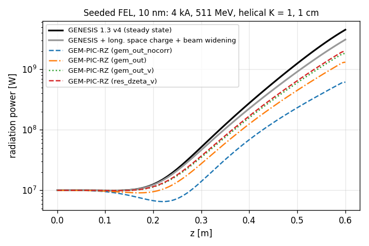
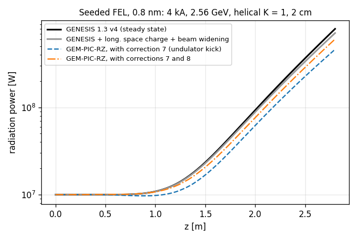
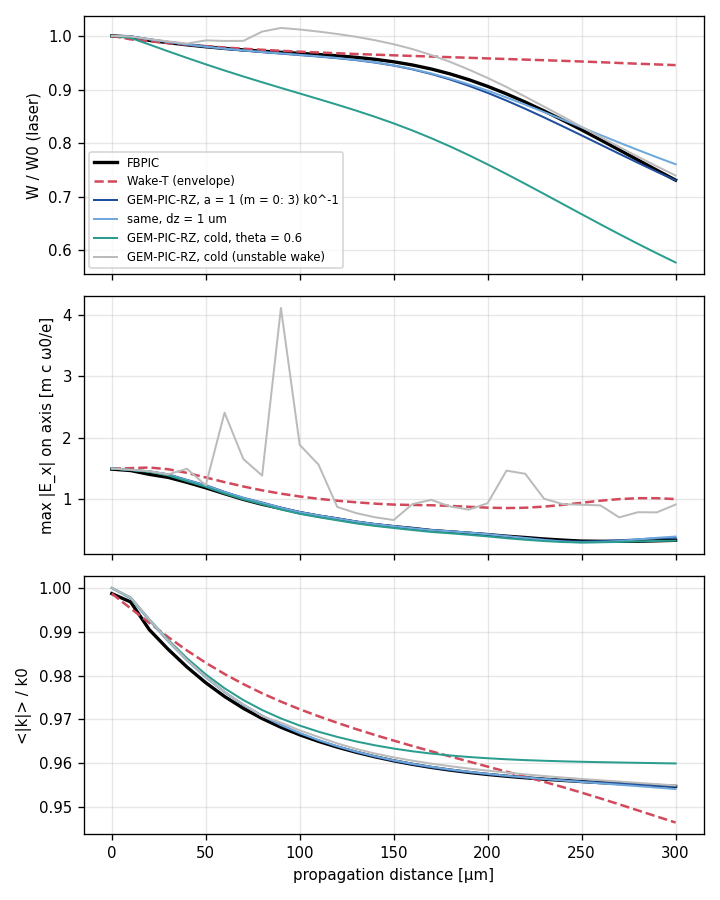
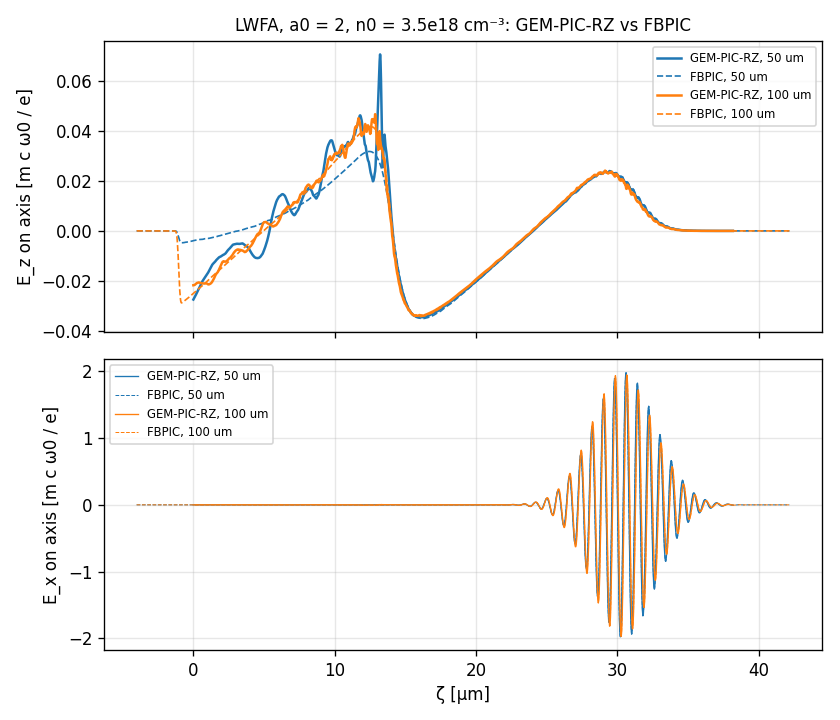

# Benchmarks against other codes

| directory | reference code | case | result |
|---|---|---|---|
| `genesis_seeded/` | GENESIS 1.3 v4 (steady state) | seeded FEL amplifiers at 10 nm and 0.8 nm | power gain length within 4 % (10 nm) and 0.6 % (0.8 nm) of GENESIS run with the same physics |
| `lwfa_fbpic/` | FBPIC 0.27 (full PIC, spectral, quasi-cylindrical) | LWFA, a0 = 2, n0 = 3.5·10¹⁸ cm⁻³ | on-axis wake E_z of the first period to 1.6 % rms; laser field to 1 %; behind the bubble with `plasma.smooth_length` |
| `ionization_fbpic/` | FBPIC 0.27 (with ADK ionization) | ionization injection from a N5+ dopant, a0 = 2.3, 3.5·10¹⁸ cm⁻³, 200 µm | injected charge above 5 MeV to 10 %, its mean energy and spectrum to 2–5 % at the same position of the bunch |
| `downramp_fbpic/` | FBPIC 0.27 | density down-ramp injection (2 → 1 n0 over 10 µm), a0 = 1.8 | **open:** GEM-PIC-RZ traps 10–25 pC above 2 MeV depending on the step, FBPIC 51 pC |
| `laser_evolution/` | FBPIC 0.27 and the envelope code Wake-T 0.9.1 | 6.8 fs pulse, a0 = 1.5, n0 = 1.7·10¹⁹ cm⁻³, 300 µm: diffraction, depletion, red-shift | laser energy to 1.3 %, red-shift to 0.002 k0, peak field to 5 % (FBPIC); Wake-T underestimates the depletion fivefold |

The runs were made on 2 CPU cores. The decks, input files and scripts are here; the GEM-PIC-RZ output
tables (`fel_power.txt`, `fel.txt`, `bunches.txt`, axis files), the GENESIS outputs (`*.out.h5`) and the FBPIC lineouts are included.

## Seeded FEL against GENESIS 1.3 v4

Both codes amplify a 10 MW Gaussian seed (w0 = 30 µm, circular polarization) in a helical undulator, with a
round beam of 4 kA, σ_r = 10 µm, no emittance and no energy spread. Neither has natural focusing.

| case | γ | λ_u | K | periods | λ_r | ρ |
|---|---|---|---|---|---|---|
| `gem.deck` (10 nm) | 1000 | 1 cm | 1 | 60 | 10 nm | 9.1·10⁻³ |
| `gem_x.deck` (0.8 nm) | 5000 | 2 cm | 1 | 140 | 0.8 nm | 2.9·10⁻³ |

**Steady state in GEM-PIC-RZ.** GENESIS solves a single slice. GEM-PIC-RZ is time dependent, so the bunch is a
long flat top (2 µm = 200 λ_r at 10 nm, 160 nm = 200 λ_r at 0.8 nm) with smooth edges, and the seed is flat over
it. The radiation slips over the electrons by N_u λ_r. The radiation in a ζ range that met only the flat part of
the bunch behaves as in a steady-state run: ζ = 2.6 … 3.6 µm and 0.32 … 0.36 µm. Its power is read from
`fel_power.txt`, which demodulates the fields at λ_r, so the Coulomb field moving with the bunch is excluded.
Shot noise is the Fawley beamlet noise of the real electron number (`shot_noise = fawley`), negligible against
the seed. Resolution: Δζ = λ_r/16, Δz = λ_u/16, `m_max = 1`. The windows follow the box criteria of the code.

**GENESIS** (`genesis/fel.in`, `genesis_x/fel.in`): steady state, 8192 particles, field grid ±0.3 mm with 301
points (±0.2 mm at 0.8 nm), step λ_u/16 (10 nm: within 0.6 % of 601 points and λ_u/32).

**Physics that GENESIS leaves out.** GEM-PIC-RZ computes the full fields of the beam, so two effects that
standard GENESIS runs omit are present:
- **Transverse space charge.** At γ = 1000 and 4 kA it widens the beam from 10 to 12 µm over 0.6 m, as the
  envelope equation gives (σ'' = K/(4σ), K = 2I/(I_A γ³)). The nonlinear part raises the normalized emittance
  to 0.11 µm. At γ = 5000 the beam widens by 5 %.
- **Longitudinal space charge at λ_r** (GENESIS `&efield`, off by default).

For a like-for-like comparison GENESIS was also run with `&efield` and with a beam that widens the same way.
That beam diverges from a waist with β = 0.95 m and ε_n = 0.105 µm at 10 nm, and β = 8.7 m and
ε_n = 0.057 µm at 0.8 nm (`fel_sigma_sc.in`). These are the grey curves.

| power gain length (fit over 0.45 … 0.6 m and 2.0 … 2.8 m) | 10 nm | 0.8 nm |
|---|---|---|
| GENESIS | 7.45 cm | 37.4 cm |
| GENESIS + longitudinal space charge | 7.52 cm | 37.7 cm |
| GENESIS + longitudinal space charge + beam widening | **7.92 cm** | **38.4 cm** |
| GEM-PIC-RZ before corrections 7 and 8 (see the main README) | 9.53 cm | — |
| GEM-PIC-RZ with correction 7 (undulator kick averaged over the step) | 8.72 cm | 39.9 cm |
| GEM-PIC-RZ with corrections 7 and 8 (current deposited at the time of the position) | **8.33 cm** | **38.7 cm** |
| … with Δz = λ_u/32 | 8.26 cm | |
| … with Δζ = λ_r/32 | 8.28 cm | |

 

- **0.8 nm (transverse space charge small):** GEM-PIC-RZ agrees with GENESIS to 0.6 % in gain length. The
  power at the end is 0.83 of GENESIS with the same physics, and 0.75 of plain GENESIS.
- **10 nm (transverse space charge strong):** the gain length is 4 % longer than in GENESIS with the same
  physics. The remaining difference is in the nonlinear transverse dynamics, which the widening model only
  approximates (the emittance grows during the run in GEM-PIC-RZ, but is fixed in GENESIS).
- **Lethargy:** the seeded start-up (the first ~2 gain lengths) agrees closely in both cases.
- **How the corrections were found:** before the corrections the power first dropped, the sign of a detuning,
  and the gain length depended on Δz to first order. The two corrections removed both.
- **Seed helicity:** the seed must rotate with the electrons. For the undulator field of the code (B_x = B0 cos ψ,
  B_y = B0 sin ψ) that is `helicity = -1`; the other helicity is not amplified.

Reproduce:
```
cd genesis_seeded
genesis4 genesis/fel.in            # and fel_sc.in, fel_sigma_sc.in; the same in genesis_x/
gempic_rz gem.deck numerics.backend=openmp     # 12 min on 2 cores
gempic_rz gem_x.deck numerics.backend=openmp   # 34 min
python3 compare.py 10nm gem_out_nocorr gem_out gem_out_v res_dzeta_v
python3 compare.py 0.8nm gemx_out_nocorr gemx_out   # gemx_out_nocorr: with correction 7 only
```
GENESIS 4 was built from github.com/svenreiche/Genesis-1.3-Version4 (v1.10.10) against serial HDF5. That needed a
small shim header defining `H5Pset_fapl_mpio` and `H5Pset_dxpl_mpio` as no-ops; it was run on one MPI rank.

## Ionization injection against FBPIC

The LWFA case of `lwfa_fbpic/` with a0 = 2.3 (no self-injection) and a nitrogen dopant: N5+ ions with 1 % of the
free-electron density (3.48·10¹⁸ cm⁻³, 0.002 n_c, 20 µm linear ramp), field-ionized by ADK to N6+ and N7+ near the peak
of the pulse. The K-shell electrons released there slip back and are trapped in the bubble.
- **FBPIC** (`fbpic_ionization.py`): Δz = λ/24, Δr = 0.2 µm, 2 modes, electrons 8 and ions 16 particles per cell,
  `make_ionizable('N', level_start=5)`; 3.4 h on 2 cores for 200 µm.
- **GEM-PIC-RZ** (`gem.deck`): the grid of `lwfa_fbpic/`, Δ = 2.5 µm (and 1.25 µm), mobile N ions with ADK,
  `smooth_length = 2 k0^-1`; 8.5 min on one core.
- **Comparison** (`python3 ../compare_injection.py ionization gem_out gem_out_dz1.25`): electrons from nitrogen above
  5 MeV. GEM-PIC-RZ's level s is the plane z = s, and its trapped electrons are at the lab position z = s. An FBPIC
  output at ct holds the bunch 17 µm behind the laser, at z = ct − 17 µm. The two are therefore compared at the
  same lab position of the bunch, not at the same s and ct; at the same s and ct the bunch in GEM-PIC-RZ is 17 µm
  further on.

| lab position of the bunch | Q(E > 5 MeV): FBPIC / GEM Δ = 2.5 / 1.25 µm | ⟨E⟩ [MeV] | ΔE_rms [MeV] |
|---|---|---|---|
| 84 µm (FBPIC ct = 100 µm) | 0.48 / 0.45 / 0.47 pC (GEM interpolated) | 6.6 / 6.7 / 6.6 | 1.2 / 1.2 / 1.2 |
| 183 µm (ct = 200 µm; GEM run to s = 182.5 µm) | 1.76 / 1.58 pC | 12.6 / 12.4 | 5.4 / 5.2 |

- The ionized fraction of the dopant agrees (3.2 % N6+ and 0.3 % N7+ behind the laser), as do the peak laser field
  (2.29 vs 2.27) and the wake.
- Above 5 MeV the spectra agree up to the highest energy (26 vs 25 MeV). Below about 4 MeV FBPIC has more electrons:
  sheath electrons that are not trapped, which GEM-PIC-RZ streams through the window.
- Without the source smoothing GEM-PIC-RZ traps 30 % more charge than FBPIC (0.95 instead of 0.73 pC at s = 100 µm).

## Density down-ramp injection against FBPIC (open issue)

The laser of `lwfa_fbpic/` with a0 = 1.8 crosses a plateau of 2 n0 (n0 = 0.002 n_c), which drops linearly to n0
between z = 60 and 70 µm. The wake lengthens behind the ramp, and background electrons are trapped there. Without
the ramp (constant 2 n0) GEM-PIC-RZ traps nothing; with it, the trapping starts at the ramp, as in FBPIC.
The trapped charge does not agree and does not converge with the step:

| electrons above 2 MeV, bunch at z ≈ 136–150 µm | Q [pC] | ⟨E⟩ [MeV] |
|---|---|---|
| FBPIC (ct = 150 µm, bunch at 136 µm) | 51.0 | 4.1 |
| GEM-PIC-RZ Δ = 2.5 µm | 9.9 | 6.0 |
| Δ = 1.25 µm | 20.9 | 6.6 |
| Δ = 0.5 µm | 12.2 | 5.6 |
| Δ = 0.25 µm (to 150 µm) | 14.2 | 6.5 |
| Δ = 0.125 µm in the ramp, 1.25 µm elsewhere | ≈ 31 (at 115 µm) | 2.1 |

Findings so far:
- **Before the ramp:** the plateau wake agrees with FBPIC to 2·10⁻³ m c ω0/e rms for Δ = 2.5 and 1.25 µm.
- **What changes the charge:** in a free-hand z grid, the steps before and after the ramp change it as much as the
  steps inside it. `numerics.trap_advance` (electrons kept in their level for several steps) suppresses the
  trapping almost completely (4 pC). `vz_beam = 0.99` changes little, and neither does stronger smoothing of the wake.
- **Interpretation:** the trapped electrons sit at the back of a bubble that lengthens by about 30 % over 10 µm.
  In GEM-PIC-RZ a streaming electron sees the fields of one level until its z has advanced by Δ, and then
  continues in the next level or on the beam list. The non-monotonic dependence on Δ points to this level
  switching (cf. "Bubble closure" in the main README) rather than to the neglect of ∂_s in the reduced field
  equations. The latter is also strained here, though, since the back of the bubble moves at about 0.5 c through
  the window.
- **Not yet tested:** a ramp several plasma wavelengths long.

## Laser evolution against FBPIC and Wake-T

A short, intense pulse in a dense plasma, followed for 300 µm, six Rayleigh lengths: it diffracts, gives a quarter of
its energy to the wake and is red-shifted by 4.5 %. Same case in the three codes (`gem.deck`, `fbpic_laser.py`,
`waket_laser.py`):
- **Laser:** a0 = 1.5, w0 = 3.56 µm (28 k0⁻¹, P/P_c = 0.56), field 1/e half length 2.04 µm (6.8 fs; 8.0 fs FWHM of
  the intensity), λ = 0.8 µm, linear polarization, starting at focus.
- **Plasma:** n0 = 0.01 n_c = 1.74·10¹⁹ cm⁻³ after a 10 µm linear ramp, immobile ions.
- **Window:** 24.95 µm (two plasma periods and a half), laser centre 18.6 µm from the rear.
- **FBPIC:** Δz = λ/24, Δr = 0.125 µm, 2 modes, 8 particles per cell, open boundaries.
- **GEM-PIC-RZ:** h = 0.2 k0⁻¹, Δ = 2 µm (and 1 µm), 130 radial cells (0.3 k0⁻¹ on the axis), source smoothing
  `smooth_length = 1 k0^-1` and `smooth_length_m0 = 3 k0^-1` (see below).
- **Wake-T:** laser envelope + quasi-static 2D plasma model (Baxevanis–Stupakov), 490 × 150 cells, dz_fields = 1 µm,
  4 envelope substeps; results identical with twice the cells in each direction or half the step.

Diagnostics (`compare.py`): laser energy W/W0 (fields of the modes m ≥ 1; Wake-T: |i k0 a + ∂_ξ a|²), the peak of
|E_x| on the axis, and the spectral centroid ⟨|k|⟩/k0 of the laser fields.

| z | W/W0: FBPIC / GEM / Wake-T | max\|E_x\|: FBPIC / GEM / Wake-T | ⟨\|k\|⟩/k0: FBPIC / GEM / Wake-T |
|---|---|---|---|
| 100 µm | 0.967 / 0.964 / 0.971 | 0.780 / 0.793 / 1.045 | 0.9665 / 0.9668 / 0.9723 |
| 200 µm | 0.906 / 0.894 / 0.958 | 0.424 / 0.429 / 0.862 | 0.9574 / 0.9574 / 0.9592 |
| 300 µm | 0.731 / 0.731 / 0.945 | 0.331 / 0.372 / 1.002 | 0.9547 / 0.9546 / 0.9464 |



- **GEM-PIC-RZ vs FBPIC:** over the whole 300 µm the laser energy agrees to 0.013 (of W0), the red-shift to
  0.0023 k0 and the peak field to 5 % (13 % at the end, where the pulse is weak and spread). The wake on the axis
  at 300 µm agrees too. With Δ = 1 µm the results are the same to within 0.03 in W/W0.
- **Wake-T:** in the envelope model the pulse stays focused (peak field 1.0 instead of 0.33 at 300 µm), drives a
  wake several times stronger and loses only 5.5 % of its energy instead of 27 %. The pulse is 2.5 laser cycles long
  and loses 4.5 % of its frequency, where the assumptions of the envelope model (slowly varying envelope,
  ω0 ≫ ω_p) are strained. Resolution does not change this.
- **Cost:** GEM-PIC-RZ 6.7 min on one core (Δ = 2 µm), FBPIC 3.7 h on two cores, Wake-T 10 min on one core.

**Stability in a dense plasma.** At 0.01 n_c the cold-plasma run (`gem_out`) is unstable: E_z behind the laser
reaches ±1 (FBPIC: 0.05) and electrons are trapped spuriously, while the laser diagnostics stay close to FBPIC.
These are the fast spurious modes of the main README ("Bubble closure"): they change sign from step to step and
grow at the density spikes of the nonlinear wake. Halving the step (Δ = 1 µm) delays but does not stop them in a
longer window. Remedies tried:

| GEM-PIC-RZ | wake 3–4 periods behind the laser (window extended by 10 µm, 50 µm), max\|E_z\| | laser W/W0 at 300 µm |
|---|---|---|
| cold, Δ = 2 µm | 1.18 | (unstable) |
| cold, Δ = 1 µm | 0.16 | 0.757 |
| a = 1 k0⁻¹ | 1.18 | 0.732 |
| a = 3 k0⁻¹ | 0.06 | 0.773 (smoothing of the laser-driven currents changes the laser) |
| a = 3 k0⁻¹ for m = 0 only | 0.07, but the m = 1 fields grow at the rear | |
| **a = 1 k0⁻¹, m = 0: 3 k0⁻¹** | **0.07** | **0.731** |
| θ = 0.6 | 0.09 | 0.578 (damps the laser) |
| FBPIC | 0.06 | 0.731 |

The wake needs a smoothing length of about 0.3 c/ω_p at this density, the laser-driven (m = 1) currents only
0.1 c/ω_p; `plasma.smooth_length_m0` sets the first, `plasma.smooth_length` the second.

Reproduce:
```
cd laser_evolution
python3 fbpic_laser.py 300                       # fbpic_out/ (about 4 h on 2 cores)
python3 waket_laser.py 300                       # waket_out/ (pip install wake-t)
gempic_rz gem.deck output.dir=gem_out_a1m3 plasma.smooth_length=1k0^-1 plasma.smooth_length_m0=3k0^-1
gempic_rz gem.deck output.dir=gem_out_a1m3_dz1 plasma.smooth_length=1k0^-1 plasma.smooth_length_m0=3k0^-1 grid.dz=1um output.every=10
python3 compare.py                               # compare.png, table (HDF5 files -> laser_<run>.txt)
```

## LWFA against FBPIC

`lwfa_fbpic/gem.deck` and `lwfa_fbpic/fbpic_lwfa.py` set up the same case:
- **Laser:** a0 = 2, w0 = 8.02 µm, field 1/e half length 3.18 µm (τ = 10.6 fs), λ = 0.8 µm, linear polarization,
  starting at focus.
- **Plasma:** n0 = 3.48·10¹⁸ cm⁻³ (0.002 n_c) behind a 20 µm linear ramp, column radius 19.1 µm, immobile ions.
- **FBPIC grid:** Δz = λ/32, Δr = 0.2 µm, 2 modes, 16 particles per cell, open boundaries.
- **Comparison:** at ct = 50 and 100 µm.

| | GEM-PIC-RZ | FBPIC |
|---|---|---|
| first wake period, min E_z on axis at 100 µm [m c ω0/e] | −0.0339 | −0.0342 |
| rms difference of E_z over the first period | 1.6 % of the peak | |
| laser peak E_x at 100 µm | 1.971 | 1.954 |
| run time on one core | 1.7 min | ~1.5 h |



- **At 100 µm,** where the plasma behind the laser is uniform, the first period agrees to 1.6 % rms.
- **Behind the bubble** (ζ < 13 µm) the cold-plasma run (`gem_out`) has oscillations on the scale of λ0 that
  FBPIC does not have, and they grow when the step is halved (`gem_out_dz1.25`). Their source is the singular
  density at the back of the bubble (main README, "Bubble closure"). With the radial smoothing of the plasma
  sources, `plasma.smooth_length = 2 k0^-1` (0.25 µm), they are gone, and the result no longer depends on the
  step (`gem_out_a2`, `gem_out_a2_dz1.25`):

| rms of E_z − E_z(FBPIC) at 100 µm [m c ω0/e] | Δ = 2.5 µm | Δ = 1.25 µm |
|---|---|---|
| behind the bubble (2 … 12.5 µm), cold | 0.0018 | 0.0098 |
| behind the bubble, a = 2 k0⁻¹ | 0.0007 | 0.0007 |
| first period, cold / a = 2 k0⁻¹ | 1.6 % / 1.9 % of the peak | |
- **At 50 µm** the rear of the FBPIC window is still in the up-ramp, so its wake there is weaker. In
  GEM-PIC-RZ the plasma of a step is loaded at the front of the window with the density n(s) of that step and
  streams through the whole window within the step. So the profile is a function of the propagation distance
  s and constant across the window. This is how the code samples the plasma profile, not an error; it matters
  only where the profile changes over a window length.
- **Coordinates:** the FBPIC profile here is shifted by the 7.64 µm between the laser centre and the window front.
  The correct mapping (a level s of GEM-PIC-RZ is the plane z = s that the laser centre crosses at t = s/c, the
  GT2 transformation) has no shift, as used in `ionization_fbpic/` and `laser_evolution/`. The shift matters only
  in the up-ramp; at 100 µm the plasma is uniform in both.

Reproduce:
```
cd lwfa_fbpic
python3 fbpic_lwfa.py 50,100     # writes fbpic_D50.txt, fbpic_D100.txt (pip install fbpic pyfftw)
gempic_rz gem.deck numerics.backend=openmp
gempic_rz gem.deck numerics.backend=openmp output.dir=gem_out_a2 plasma.smooth_length=2k0^-1
gempic_rz gem.deck numerics.backend=openmp output.dir=gem_out_a2_dz1.25 plasma.smooth_length=2k0^-1 grid.dz=1.25um output.every=40
gempic_rz gem.deck numerics.backend=openmp output.dir=gem_out_dz1.25 grid.dz=1.25um output.every=40
python3 compare.py                 # or: python3 compare.py gem_out_a2
```
