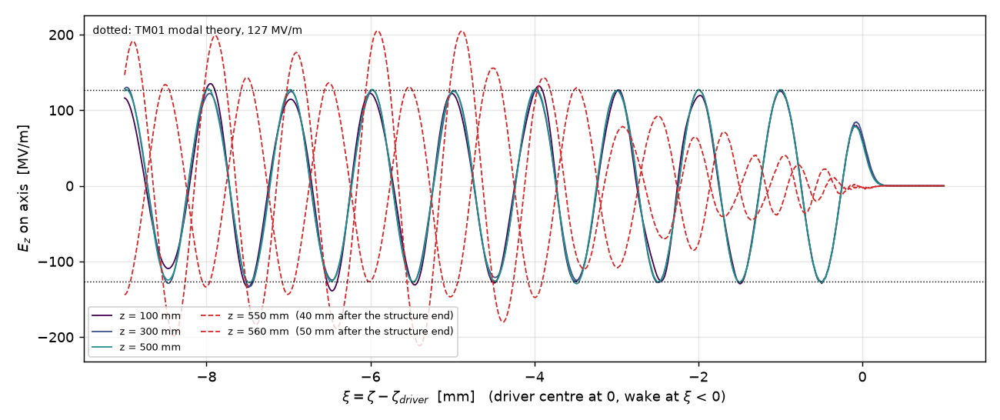
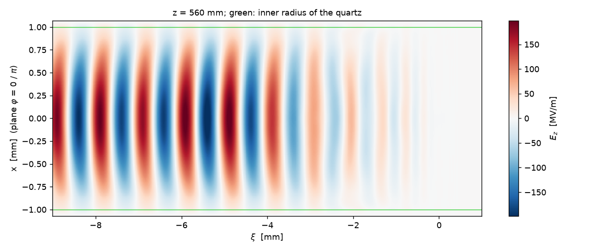
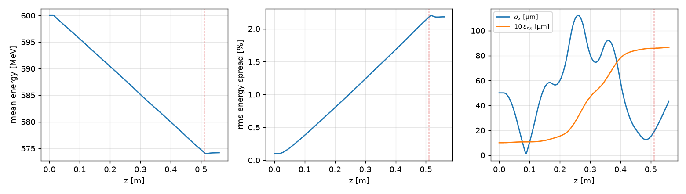

# Dielectric wakefield structure: electron drive beam, proton microbuncher, proton "klystron"

Decks for the configuration of A. Petrenko and I. Sheinman (RuPAC 2016, TUPSA041), generated by `make_deck.py`.

**Structure.** A quartz-lined copper tube:
- vacuum channel R_c = 1 mm;
- quartz ε = 3.75 up to R_w = 1.061 mm (d = 61 µm);
- copper wall at R_w.

**Drive beam.** Electrons:
- Q = 5 nC, W0 = 600 MeV;
- σ_z = 0.1 mm, σ_x = σ_y = 0.05 mm;
- normalized emittance 1 mm·mrad.

**Focusing.** An external FODO channel: period 11 cm, 4.7 cm quadrupoles. The pole field of the first quadrupole is
1.5 T. The following quadrupoles scale with the energy of the bunch centre.

Requires GEM-PIC-RZ with the `dielectric` block (main after PR #28). Everything used here is in the code: dielectric
lining, metal wall, quadrupoles, proton bunches, thin chicane.

## Modes of the structure (modal theory, `tests/dielectric.py`)

| mode | λ | f | β_g (Maxwell) | β_g (GEM system) | loss factor κ |
|---|---|---|---|---|---|
| TM₀₁ | 996 µm | 301 GHz | 0.8230 | 0.8285 | 15.5 V/pC/m |
| TM₀₂ | 194 µm | 1.55 THz | 0.9161 | 0.9174 | 1.44 V/pC/m |
| TM₀₃ | 100 µm | 3.0 THz | 0.9191 | 0.9203 | 0.40 V/pC/m |

The on-axis TM₀₁ wake behind 5 nC with σ_z = 0.1 mm is about 127 MV/m.

## Decks

```bash
python3 make_deck.py > drive.deck                          # electrons only, 5 m
python3 make_deck.py --protons > microbuncher.deck         # + a 25 mm slice of a 400 GeV proton bunch in the wake
python3 make_deck.py --protons --klystron > klystron.deck  # + thin chicane + a second 5 m structure
python3 make_deck.py --help                                # all parameters
gempic_rz drive.deck                                       # numerics.backend = openmp (default), cuda for a GPU
```

1. **`drive.deck`: the drive beam alone.**
   - 5 m of structure, starting 1 cm after the start of the run. The bunch starts in vacuum with its own field and
     enters the lining.
   - The bunch is offset by `--x0` (10 µm), which excites the dipole (HEM₁ₙ) wakes. This is the check of BBU /
     hosing against the analytic estimates of Baturin and Zholents (PRAB 21, 031301 (2018); PRSTAB 17, 091302
     (2014)).
   - `bunches.txt` gives σ_x, σ_y, the emittances and E for every step, but not the centroid. For the centroid x(ζ)
     use the particle output (`output.particles = true`, set in the decks).
2. **`microbuncher.deck`:** with a 25 mm slice of the SPS bunch in the wake.
   - 400 GeV, 4 nC: ~10⁹ p/mm near the centre of 3·10¹¹ p with σ_z = 12 cm.
   - σ_r = 0.2 mm, ε_n = 3 µm.
   - Its energy modulation at the 1 mm wavelength is the microbunching.
3. **`klystron.deck`:** after the first structure, a thin chicane with R56 = 0.16 m.
   - It turns the energy modulation into density modulation. The electrons (δ ≈ −1) leave the window.
   - Then a second structure of the same length, which the microbunched protons drive resonantly.
   - Proton focusing: `--p-quads G` (T/m) puts a FODO of the same geometry with a constant gradient there. It is
     not chosen yet.

## Parameters to check (assumptions of the generator)

- **Pole radius `--r-pole` (1.5 mm):** sets G = B_pole / r_pole = 1000 T/m. With Bρ = 2.0 T·m at 600 MeV, the thin-lens
  phase advance is about 80° per period. A smaller radius gives a stronger lens (1.06 mm: 1410 T/m, close to 180°).
- **Energy taper:** the gradients follow E(z) of the bunch centre.
  - The first run uses a linear guess, `--dWdz` = 50 MeV/m.
  - Then take the energies from the run: `python3 make_deck.py --energy-table run/bunches.txt > drive2.deck`.
    `E[MeV]` there is the mean energy of the bunch.
  - Iterate once or twice.
- **Beam:** σ_z = 0.1 mm and σ_x = σ_y = 0.05 mm (the e-mail lists σx twice); emittance 1 µm normalized; energy spread
  0.1 %.
- **Proton slice:** charge, length, size and emittance are given with `--p-charge` and `--p-length`, and in the deck.
- **Chicane:** R56 = 0.16 m is a first estimate, about λ/4 for δ ≈ 1.6·10⁻³. That is ±127 MV/m × 5 m on 400 GeV.
  `delay = 0`.

## Resolution and cost

- **Radial grid:** 153 cells. 5 µm at the beam (σ = 50 µm), 15 µm in the channel, 3 µm in the quartz (k⊥ dr ≲ 0.2 for
  TM₀₃).
- **Along ζ:** dζ = 4 µm, 25 cells per σ_z and 250 per TM₀₁ period. The window is 10 mm (drive) or 30 mm (with protons).
- **Steps:** dz = 2 mm field steps. The beam push takes 1 mm sub-steps (≤ 0.1/k_β of the quadrupoles).
- **Cost:** 2530 steps for 5 m.

## Plots and the structure exit

```bash
python3 plot_wake.py run              # wake_axis.png, wake_map.png, beam.png in run/ (numpy + matplotlib)
```

- `wake_axis.png`: on-axis E_z against ξ = ζ − ζ_driver (driver centre at 0, wake at ξ < 0), one curve per output
  step, with the modal theory ±127 MV/m dotted.
- `wake_map.png`: E_z(ξ, x) at the last step.
- `beam.png`: energy, energy spread, σ_x and ε_nx of the driver against z.
- The script reads the text output (`axis_*`, `map_*`, `bunches.txt`). The same fields are in the openPMD files
  `fields_*.h5` (openPMD-viewer).

**Example: a short run** (`figures/`): `python3 make_deck.py --length 0.5 --every 25 > short.deck`, 280 steps,
2 min on 24 cores, then `python3 plot_wake.py run --steps 50 150 250 275 280`.


- Inside the lining (z = 100, 300, 500 mm) the wake is steady at the modal value 127 MV/m.
- The dashed curves are 40 and 50 mm after the end of the lining (see the structure exit below).



- The bunch loses 52 MeV/m at the centre; the rms energy spread grows to 2.2 % over 0.5 m.
- σ_x = 50 µm with ε_n = 1 µm is far from matched to this FODO. The matched beta is ~0.1–0.2 m, so the matched
  σ is ~10 µm. The envelope oscillates (σ_x down to ~2 µm at z = 9 cm), and with the energy spread ε_nx grows
  to 8.7 µm.
- The bunch starts at a waist; matching it (σ_x, σ_y in the deck) is left to the user.

**Structure exit.** The run continues `--exit` (5 cm) beyond the end of the lining in the empty copper pipe. Steps after
`dielectric.z_end` no longer show the wake of the structure:
- The quartz mode turns into the modes of the empty pipe (TM₀₁ and TM₀₂ propagate at 301 GHz). On the axis the field
  rises and beats, e.g. to 230–260 MV/m 5 cm after the exit.
- The bunch no longer drives a wake (v = c in a smooth pipe). Behind it, a zone of length (1 − β_g) Δz empties:
  - β_g = 0.934 for TM₀₁ of the empty pipe (GEM system 0.9336, Maxwell 0.9332);
  - so 3.3 mm after Δz = 5 cm.
- Measured (drive deck, 0.1 m structure; |E_z|max on the axis in 1 mm bins behind the driver):

  | z | 0–1 mm | 1–2 | 2–3 | 3–4 | 4–5 | further back |
  |---|---|---|---|---|---|---|
  | 100 mm (inside the lining) | 129 | 129 | 126 | 132 | 128 | 128–138 |
  | 160 mm (5 cm after the exit) | 34 | 54 | 80 | 151 | 243 | 229–260 |

- The reflection at the end of the lining is not in the model (backward wave).
- With `--length 0.5` (a 1/10 test) the last output step is in the pipe. Compare the wake at steps with
  z < `dielectric.z_end`.

## Model limits

- **Backward waves:** the GEM system drops them. Reflections at the ends of the structure and between the two
  structures are missing.
- **Energy flow:** the energy flow of non-synchronous fields is that of the reduced system. For this thin lining the
  group velocity is 0.8285c instead of 0.8230c, so the wake fills behind the bunch ~4 % differently. The steady wake
  (wavenumbers, amplitudes) is exact.
- **Not modelled:** losses in the copper and in the quartz (tan δ), and the dispersion of quartz.
- **Thin chicane:** without dispersion in x and without synchrotron radiation.
